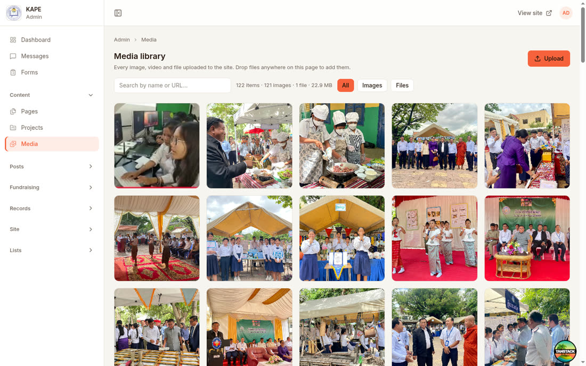

# Running the site from the admin

Six tours for the people who keep a site up to date.
Each one is a job you actually have to do, start to finish, with the screen names you will see.

Nothing here needs a developer.
If a tour tells you to do something and the screen does not offer it, that is a bug, not a missing skill.

| Tour | You will be able to |
|---|---|
| [1. Getting your bearings](#1-getting-your-bearings) | Sign in, read the sidebar, find any screen |
| [2. Building a page](#2-building-a-page) | Create a page, stack sections on it, publish it |
| [3. Writing a post](#3-writing-a-post) | Publish news, a story, a job, a report |
| [4. Working with media](#4-working-with-media) | Upload, reuse, and delete files safely |
| [5. Menus, footer and settings](#5-menus-footer-and-settings) | Put a page in the menu, change what the site says about itself |
| [6. People, forms and messages](#6-people-forms-and-messages) | Let colleagues in, collect answers, read what visitors sent |

A shorter version of all six is in [CHEATSHEET.md](CHEATSHEET.md). Print that one.

---

## 1. Getting your bearings

### Sign in

Go to `/admin`. If you are not signed in you land on `/login`, and after signing in you are returned
to the screen you asked for, not to the dashboard.

If you sign in and see "no areas" rather than a sidebar, your account exists but your role has not
been given anything to manage. That is tour 6's job, and someone with an administrator account has
to do it for you.

### The dashboard

**Overview** is what is happening across the site: recent activity, counts, and the two things you
are most likely to want next — **New post** and **New page**.

### The sidebar

Three things are always at the top, because they are the ones with something waiting in them:

- **Dashboard**
- **Messages** — what visitors sent through the contact form
- **Forms** — the forms themselves, and their submissions

Below that, everything is grouped. One group opens at a time, and the one you left open is still
open when you come back.

| Group | What lives there |
|---|---|
| **Content** | Pages, Projects, Media |
| **Posts** | All posts, then one entry per kind: News, Stories, Videos, Galleries, Publications, Careers, Events, Documents, Announcements, Internal news |
| **Fundraising** | Campaigns, Donations |
| **Records** | Schools, People, Partners, Donors, Offices |
| **Site** | Header, Footer, Org Chart, Languages, UI Strings, Users, Roles, Settings, Modules |
| **Lists** | Locations, and the category lists that fill the dropdowns elsewhere |

**You will not see all of it.** The sidebar only shows what your role can reach, and what your
install has switched on under Modules. A short sidebar is normal.

### The topbar

- The panel button at the top of the sidebar collapses it. It remembers. Collapsed, the logo turns
  back into that button when you point at it.
- **Tour** walks you through the screen you are on.
- **View site** opens the public site in a new tab. Use it constantly.
- Your initials open the account panel: your details, the theme toggle and sign out.

**Tour** walks you through whatever screen you are on, pointing at each control in turn.
Every screen in the sidebar has its own, and so do the editors, the page builder and the form
builder, so press it anywhere you are not sure.
It runs by itself the first time you open the admin and the first time you open the media library.

`N` moves to the next step and `P` back to the previous one. **End tour** leaves at any step, and so
does Escape.

### Finding things

Every list has the same three parts in the same place: a search box, a live count beside it, and
filter chips for the states that list has. Search matches on **words, in any order** — searching
`sen hun` finds "Hun Sen".

The breadcrumb under the topbar always gets you back up a level. There is no need to use the
browser's back button.

---

## 2. Building a page

A page is a **stack of sections**. You do not write HTML and you do not pick a template — you add
the sections you want, in the order you want them, and each one has its own fields.

### Create it

**Pages → New page.**

| Field | What it does |
|---|---|
| **Title** | The heading, and what shows in menus |
| **Brief** | A one-line summary. Used in listings and search results |
| **Parent page** | Leave at "Top level", or nest it under an existing page |
| **URL segment** | The last part of the address. Lowercase, hyphens, no spaces |
| **Status** | **Draft** or **Published** |

The parent plus the URL segment make the address. A page with parent `who-we-are` and segment
`history` lives at `/who-we-are/history`.

**Nothing is public until Status is Published.** You can save a draft as often as you like.

### Add sections

**+ Add section** opens the catalogue. Pick the shape you want, fill it in, add another.

| Section | Use it for |
|---|---|
| **Hero** | The big banner at the top of a page |
| **Rich text** | Ordinary writing: headings, lists, links, images, tables |
| **Text + media** | A block of writing beside a picture or video |
| **Feature cards** | Two to four things, side by side, each with an icon and a line |
| **Stats band** | Numbers you want people to notice |
| **Call-to-action band** | One sentence and one button |
| **Pill links** | A row of small links, for jumping between related pages |
| **Resource cards** | Downloads and outbound links |
| **Certificate grid** | Awards, accreditations, recognitions |
| **Form** | Drop one of your forms into the page |
| **Map with pins** | Locations on a map |
| **Site map** | An automatic index of the whole site |
| **Organization chart** | The org chart from the Org Chart screen |

And the ones that pull in records you have already entered, so you never type a list twice:
**Post list**, **Video gallery**, **Photo albums**, **Publication / document list**,
**People directory**, **Directory table**, **Partners**, **Project list**.

Sections can be reordered and removed after the fact. Add one, save, look at the public page,
adjust. That loop is faster than getting it right in your head first.

### Write both languages

Every text field sits behind **language tabs**. Fill in English, switch tab, fill in the other
language. It is the same field and the same page — only the words differ.

A field you leave blank in one language stays blank on that language's version of the site. It does
not fall back to the other language.

### Publish

Set **Status** to Published and **Save page**.

Then use **View site** and look at it. Publishing is not the last step; looking is.

---

## 3. Writing a post

A post is dated content that gets its own public page. Pages are the structure of the site; posts
are what happens on it.

### Pick the kind first

**Posts** in the sidebar lists every kind. Choosing the right one decides where the post appears on
the public site and which listing sections can pull it in.

| Kind | For |
|---|---|
| News | Announcements and updates with a date |
| Stories | Longer human-interest writing |
| Videos | A post whose point is the video |
| Galleries | A set of photos |
| Publications | Reports and research |
| Documents | Files people download |
| Careers | Job openings |
| Events | Things with a date and a place |
| Announcements | Internal notices |
| Internal news | Staff-only updates |

Some kinds never get a public page of their own — announcements and internal news among them. They
still exist, they are still listed inside the admin, and other screens can point at them.

### Fill it in

**New post**, then the same shape as a page: title, brief, slug, status, language tabs.

Two extras matter:

- **Cover image** — the picture used in listings and previews. Pick it from the media library.
- **Body** — the rich text editor.

### The editor toolbar

Left to right: **Bold**, **Italic**, **Heading 2**, **Heading 3**, **Bulleted list**, **Quote**,
**Link**, **Image**, **Table**, **Terms**, **Form**, **Undo**, **Redo**.

- **Image** opens the media library. Pick an existing file or upload one — either way it lands in
  the body where your cursor is.
- **Table** inserts a table and gives you the row and column controls.
- **Form** embeds one of your forms mid-article.
- **Terms** inserts a definition list.

### Publish

Set the status, save, and open the public page. Same rule as pages: look at it.

---

## 4. Working with media

**Content → Media** is every file on the site: images, video and documents, in one place.

### Upload

Two ways, and they do the same thing:

- **Upload** in the header, which lets you pick several files at once.
- **Drag files onto the page.** Anywhere on the page. A dashed panel appears to confirm you are over
  a drop target.

Uploads that are refused tell you why. The two you will hit:

- **"File type ... is not allowed"** — the file's extension is not on the allowed list. This is a
  security limit, not a setting. Convert the file, or ask an administrator.
- **"That file is empty"** — a zero-byte file, usually a failed download or a bad export.

Give files sensible names before you upload them. **The library stores them under a generated
name**, so a file called `IMG_4471.jpg` and one called `graduation-2026.jpg` are equally
unrecognisable afterwards. What makes an item findable is where it is used, not what it was called.

### Find and reuse

Search matches the file's stored name and its address. The chips narrow to **All**, **Images** or
**Files**.

Any picker anywhere in the admin — a cover image, a logo, a section's photo — opens this same
library. Upload once, use it in ten places.

### Look at one

Click a tile. You get its type, size, dimensions, the date it was added, its address with a
**Copy URL** button, and **Used in**.

**Used in is the important part.** It lists every page, post and record that points at this file.
"Unused" means nothing references it and it is safe to remove.

### Delete safely

Select tiles with the checkbox in their corner to delete several at once, or use the bin on a single
tile.

If the file is written into someone's article text, **the delete is refused** and the message names
what is holding it. Go and remove the image there first.

If the file is only used *as* something — a cover image, a logo — the delete goes through and that
record is simply left without a picture. Nothing breaks, but check the Used in list before you
confirm, because nobody will tell you afterwards.

---

## 5. Menus, footer and settings

### Put a page in the menu

Creating a page does not add it to the menu. That is deliberate: the menu is a decision, not a
side effect.

**Site → Header** is the top navigation. Add an entry, point it at your page, and give it the label
you want in the menu — which does not have to be the page's title.

**Site → Footer** is the same job for the bottom of every page: link columns, contact details,
social links, and the logos that sit down there.

### What the site says about itself

**Site → Settings** holds the things that are true of the whole site rather than of one page: its
name, its logo, contact details, social accounts, analytics, and how it describes itself to search
engines and to people sharing links.

Change something here and it changes everywhere at once. That is the point, and it is also the risk.

### Languages

**Site → Languages** is which languages the site offers.

**Site → UI Strings** is the site's own furniture — button labels, "Read more", form messages —
translated. Your content lives on its own screens; this is everything the software says.

### Modules

**Site → Modules** switches whole areas on and off. Turning one off hides its screens from every
sidebar and stops its public pages answering. An install that does not fundraise turns off
Fundraising and nobody sees a Campaigns screen again.

Nothing is deleted. Turn it back on and it is all still there.

---

## 6. People, forms and messages

### Users and roles

**Site → Users** is who can sign in. **Site → Roles** is what each role is allowed to reach.

A user holds one role, and the role carries the areas. So you do not give a person permissions —
you make a role that describes a job, and you give people that role.

Areas a role can be given:

Pages · Posts · Projects · Media library · Forms & submissions · Campaigns & donations · People ·
Partners & donors · Schools · Offices · Contact messages · Header, footer & menus · Lists &
categories · Site settings & languages · Users & roles

Give a new colleague the narrowest role that lets them do their job. Widening a role later takes
seconds; explaining a deleted page does not.

### Forms

**Forms** builds the forms the public site can show: a contact form, an application, a survey.

Build the form, then put it on a page — either as a **Form** section, or embedded mid-article with
the editor's Form button.

Each form has its own **Submissions** screen. That is where the answers arrive.

### Messages

**Messages** is the contact form's inbox.

Check it. It does not email anyone, and nothing else tells you something is waiting.

---

## When something looks wrong

**The public page did not change.** Pages are cached. Reload once; if it still looks old, confirm
the status is Published and that you saved.

**The page is not in the menu.** Menus are edited separately, under Site → Header.

**A screen is missing from my sidebar.** Either your role does not include it, or the module is
switched off. Both are tour 5 and tour 6.

**A field is empty on one language's site.** It was left blank on that language's tab. Blank stays
blank; it does not fall back.

**A delete was refused.** The message names what is holding the thing. Remove it there first, then
delete.
