# Running the site from the admin

Six tours for the people who keep the site up to date.
Each one is a job you actually have to do, start to finish, with the screen names you will see and a
picture of the screen you will be looking at.

Nothing here needs a developer.
If a tour tells you to do something and the screen does not offer it, that is a bug, not a missing skill.

| Tour | You will be able to |
|---|---|
| [1. Getting your bearings](#1-getting-your-bearings) | Sign in, read the sidebar, find any screen |
| [2. Building a page](#2-building-a-page) | Create a page, stack sections on it, publish it |
| [3. Writing a post](#3-writing-a-post) | Publish news, a story, a job, a report |
| [4. Working with media](#4-working-with-media) | Upload, reuse, and delete files safely |
| [5. Menus, footer and settings](#5-menus-footer-and-settings) | Put a page in the menu, change what the site says about itself |
| [6. People, forms and messages](#6-people-forms-and-messages) | Let colleagues in, collect answers, read what visitors sent |

A shorter version of all six is in [CHEATSHEET.md](CHEATSHEET.md). Print that one.

The screenshots are of KAPE's own site. A few of them show sample content that was added to make a
screen worth photographing: the teacher training form, its two responses, and the two contact
messages. Everything else is real.

---

## 1. Getting your bearings

### Sign in

Go to `/admin`. If you are not signed in you land on `/login`, and after signing in you are returned
to the screen you asked for, not to the dashboard.

If you sign in and see "no areas" rather than a sidebar, your account exists but your role has not
been given anything to manage. That is tour 6's job, and someone with an administrator account has
to do it for you.

### The dashboard

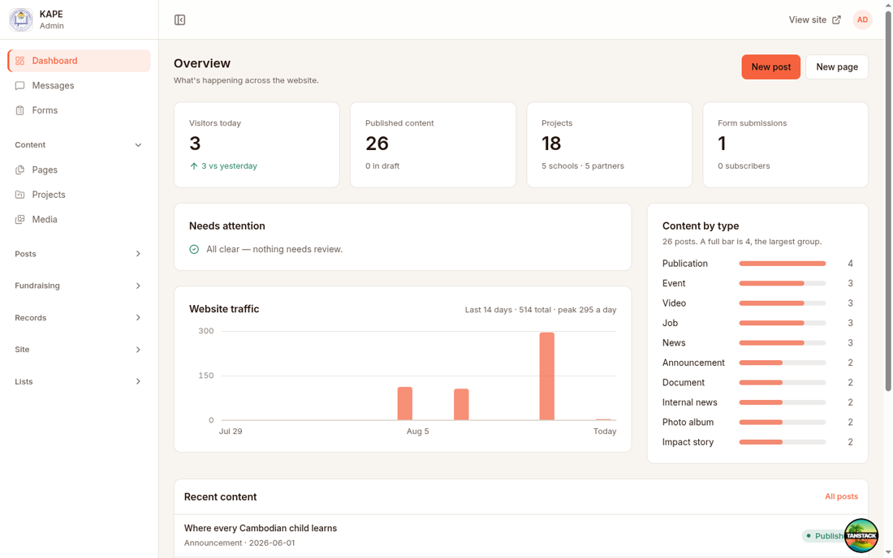

**Overview** is what is happening across the site. Four counters at the top, then **Needs attention**
— the one panel worth reading every morning, because it names anything sitting in a state somebody
has to resolve. **New post** and **New page** are in the corner because they are what you are most
often here to do.

### The sidebar

Three things are always at the top, because they are the ones with something waiting in them:

- **Dashboard**
- **Messages** — what visitors sent through the contact form
- **Forms** — the forms themselves, and their submissions

Below that, everything is grouped. One group opens at a time, and the one you left open is still
open when you come back.

| Group | What lives there |
|---|---|
| **Content** | Pages, Projects, Media |
| **Posts** | All posts, then one entry per kind: News, Stories, Videos, Galleries, Publications, Careers, Events, Documents, Announcements, Internal news |
| **Fundraising** | Campaigns, Donations |
| **Records** | Schools, People, Partners, Donors, Offices |
| **Site** | Header, Footer, Org Chart, Languages, UI Strings, Users, Roles, Settings, Modules |
| **Lists** | Locations, and the category lists that fill the dropdowns elsewhere |

**You will not see all of it.** The sidebar only shows what your role can reach, and what your
install has switched on under Modules. A short sidebar is normal.

### The topbar

- The panel button beside the logo collapses the sidebar. It remembers. Collapsed, the logo turns
  back into that button when you point at it.
- **Tour** walks you through the screen you are on.
- **View site** opens the public site in a new tab. Use it constantly.
- Your initials open the account panel.

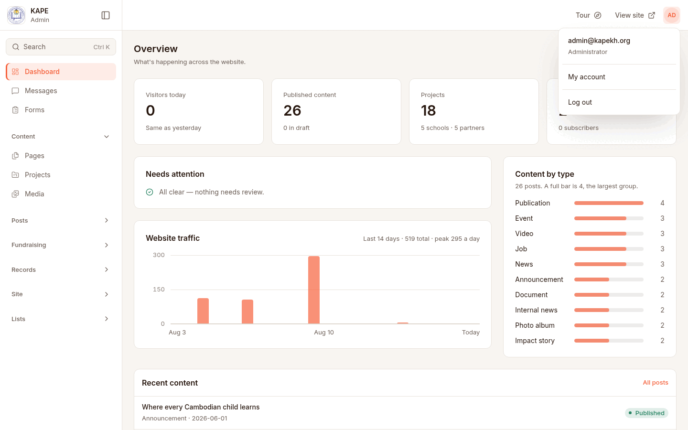

The account panel is your email, the role you hold, **My account** for your own name and password,
and **Log out**. A light/dark switch appears here too, but only on an install that has dark mode
turned on under Settings → Brand. KAPE's does not, so there is nothing to switch.

### The tour

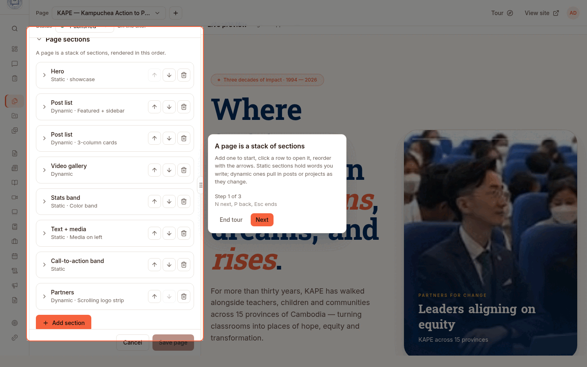

**Tour** walks you through whatever screen you are on, spotlighting each control in turn.
Every screen in the sidebar has one, and so do the editors, the page builder and the form builder,
so press it anywhere you are not sure.
It runs by itself the first time you open the admin and the first time you open the media library.

`N` moves to the next step and `P` back to the previous one. **End tour** leaves at any step, and so
does Escape.

### Jumping to a screen

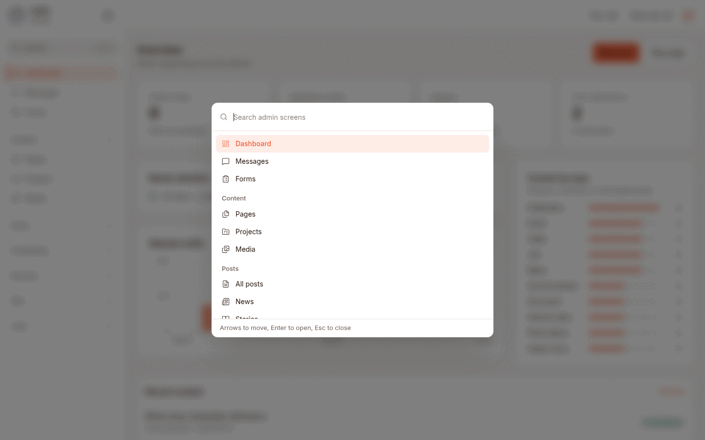

**Ctrl K** — or the Search box at the top of the sidebar — opens a list of every screen you can
reach. Type a few letters, arrow to the one you want, Enter. It is faster than the sidebar once you
know the name of the thing you want, and it works from anywhere.

It searches screen names, not your content. To find a page or a post, open that list and use its own
search box.

### Finding things in a list

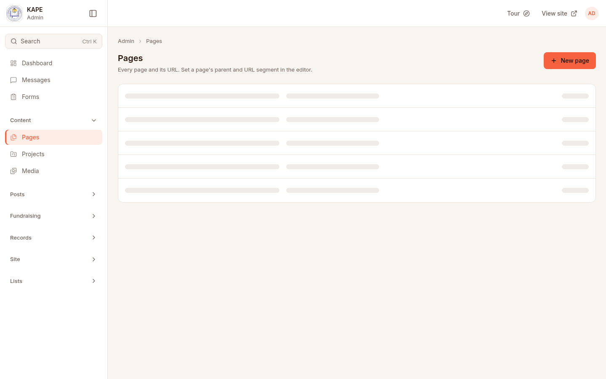

Every list has the same three parts in the same place: a search box, a live count beside it, and
filter chips for the states that list has. Search matches on **words, in any order** — searching
`sen hun` finds "Hun Sen". The count is the number of rows the search and the chips leave you with,
not the size of the list.

On the Pages list, a page nested under another is indented and carries its parent's name underneath
it, and the URL column shows the address that nesting produced.

The breadcrumb under the topbar always gets you back up a level. There is no need to use the
browser's back button.

---

## 2. Building a page

A page is a **stack of sections**. You do not write HTML and you do not pick a template — you add
the sections you want, in the order you want them, and each one has its own fields.

### The page studio

**Pages → New page** opens the studio, and so does clicking any page in the list. There is no
separate form: the page is on the left and a **live preview** of it is on the right, redrawing as you
type.

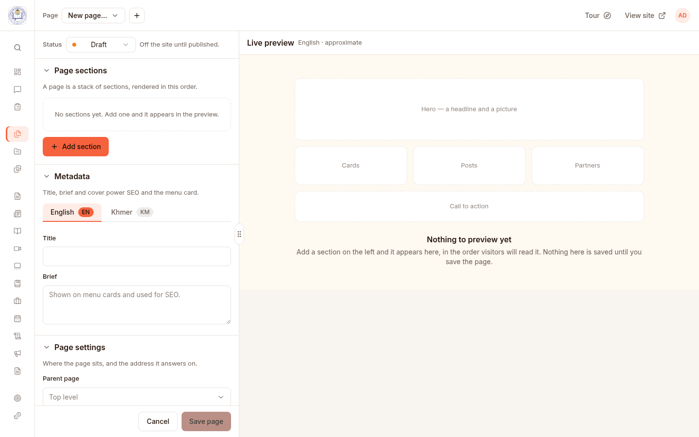

The left side is four panels, top to bottom, with **Status** above them all:

| Panel | What is in it |
|---|---|
| **Page sections** | The stack itself, and **+ Add section** |
| **Metadata** | Language tabs, **Title** and **Brief**. The title is the heading and what shows in menus; the brief is the line used on menu cards and in search results |
| **Page settings** | **Parent page** and **URL segment** — where the page sits and the address it answers on |
| **Cover image** | The picture used when this page is shown as a card |

The parent plus the URL segment make the address. A page with parent `who-we-are` and segment
`history` lives at `/who-we-are/history`. Segments are lowercase, hyphens, no spaces.

**Nothing is public until Status is Published.** You can save a draft as often as you like.

The preview is English and approximate. It is there to tell you the shape is right, not to be
trusted for the final look — that is what **View site** is for, after saving.

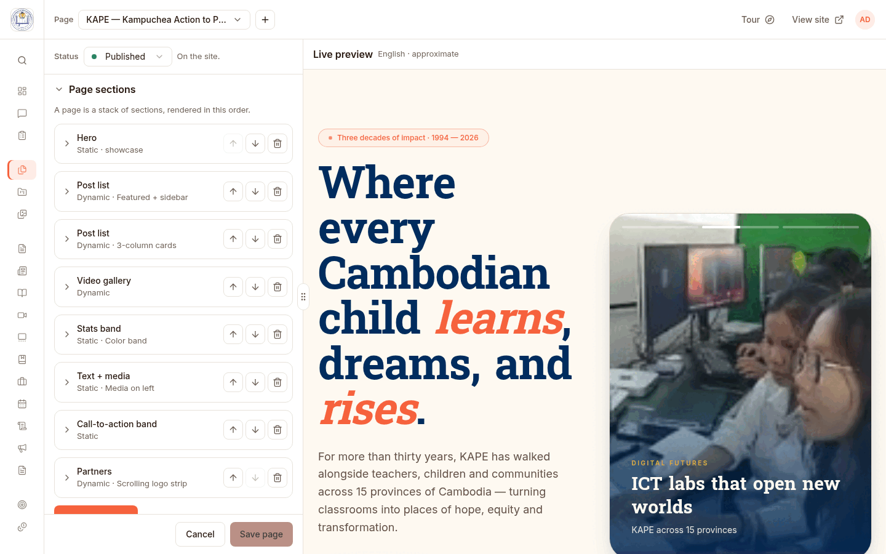

Each section row shows its name and how it is configured, with arrows to move it up or down and a bin
to remove it. Click the row itself to open its fields.

### Add sections

**+ Add section**, at the bottom of the stack, opens the catalogue.

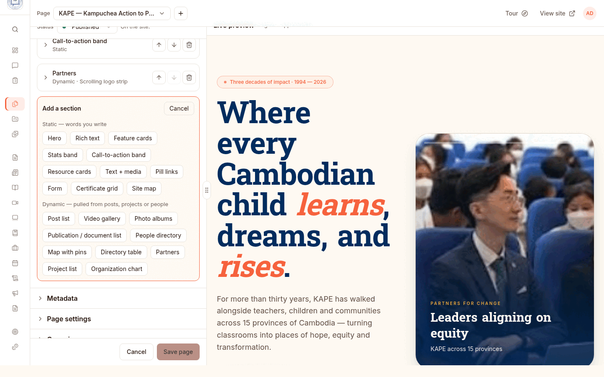

The catalogue is in two halves, and the difference matters more than any individual choice.

**Static — words you write.** The section holds exactly what you put in it and changes only when you
come back and change it.

| Section | Use it for |
|---|---|
| **Hero** | The big banner at the top of a page |
| **Rich text** | Ordinary writing: headings, lists, links, images, tables |
| **Feature cards** | Two to four things side by side, each with an icon and a line |
| **Stats band** | Numbers you want people to notice |
| **Call-to-action band** | One sentence and one button |
| **Resource cards** | Downloads and outbound links |
| **Text + media** | A block of writing beside a picture or video |
| **Pill links** | A row of small links, for jumping between related pages |
| **Form** | Drop one of your forms into the page |
| **Certificate grid** | Awards, accreditations, recognitions |
| **Site map** | An automatic index of the whole site |

**Dynamic — pulled from posts, projects or people.** You choose what it should show and how many;
the section then keeps itself up to date as records are added. Put a Post list on a page and every
future news item appears there without anyone editing the page again.

**Post list** · **Video gallery** · **Photo albums** · **Publication / document list** ·
**People directory** · **Map with pins** · **Directory table** · **Partners** · **Project list** ·
**Organization chart**

Add one, save, look at the public page, adjust. That loop is faster than getting it right in your
head first.

### Write both languages

Every text field sits behind **language tabs**. Fill in English, switch tab, fill in the other
language. It is the same field and the same page — only the words differ.

A field you leave blank in one language stays blank on that language's version of the site. It does
not fall back to the other language.

### Publish

Set **Status** to Published and **Save page**.

Then use **View site** and look at it. Publishing is not the last step; looking is.

---

## 3. Writing a post

A post is dated content that gets its own public page. Pages are the structure of the site; posts
are what happens on it.

### Pick the kind first

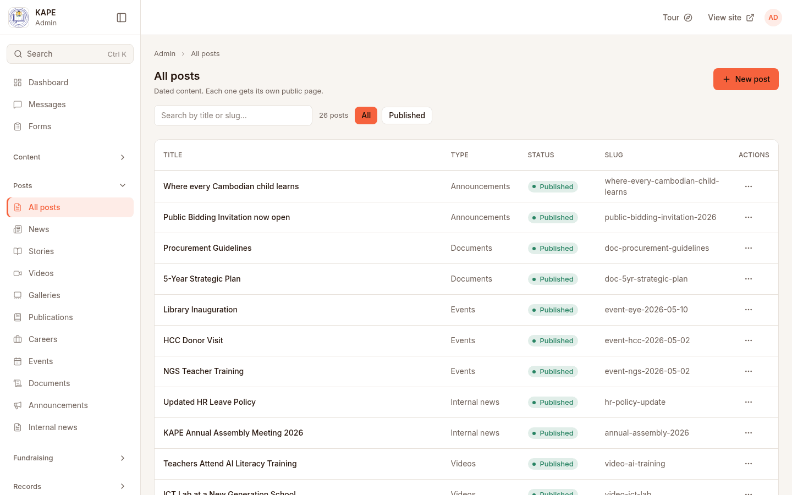

**Posts** in the sidebar lists every kind. Choosing the right one decides where the post appears on
the public site and which listing sections can pull it in.

| Kind | For |
|---|---|
| News | Announcements and updates with a date |
| Stories | Longer human-interest writing |
| Videos | A post whose point is the video |
| Galleries | A set of photos |
| Publications | Reports and research |
| Documents | Files people download |
| Careers | Job openings |
| Events | Things with a date and a place |
| Announcements | Internal notices |
| Internal news | Staff-only updates |

Some kinds never get a public page of their own — announcements and internal news among them. They
still exist, they are still listed inside the admin, and other screens can point at them.

### Fill it in

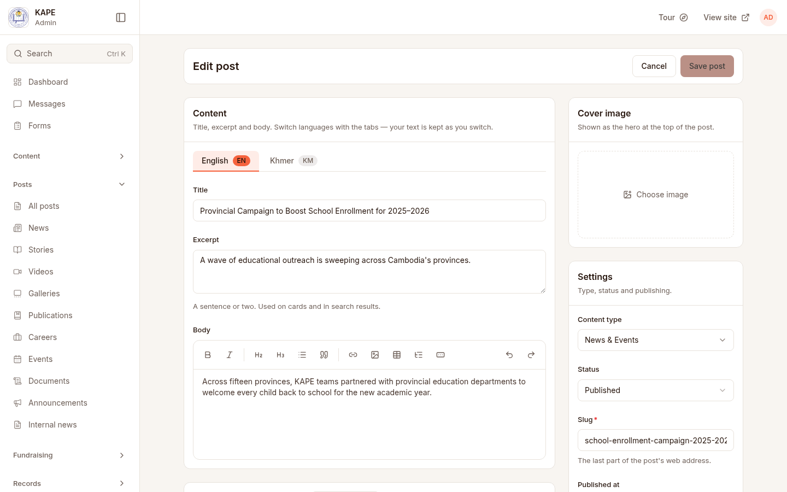

**New post**, then the same shape as a page: title, excerpt, body, and the language tabs across the
top of the content panel.

The right-hand column is everything about the post rather than in it: **cover image** (the picture
used in listings and as the hero at the top of the post), content type, status, slug and the
published date.

### The editor toolbar

Left to right: **Bold**, **Italic**, **Heading 2**, **Heading 3**, **Bulleted list**, **Quote**,
**Link**, **Image**, **Table**, **Terms**, **Form**, **Undo**, **Redo**.

- **Image** opens the media library. Pick an existing file or upload one — either way it lands in
  the body where your cursor is.
- **Table** inserts a table and gives you the row and column controls.
- **Form** embeds one of your forms mid-article.
- **Terms** inserts a definition list.

### Publish

Set the status, save, and open the public page. Same rule as pages: look at it.

---

## 4. Working with media

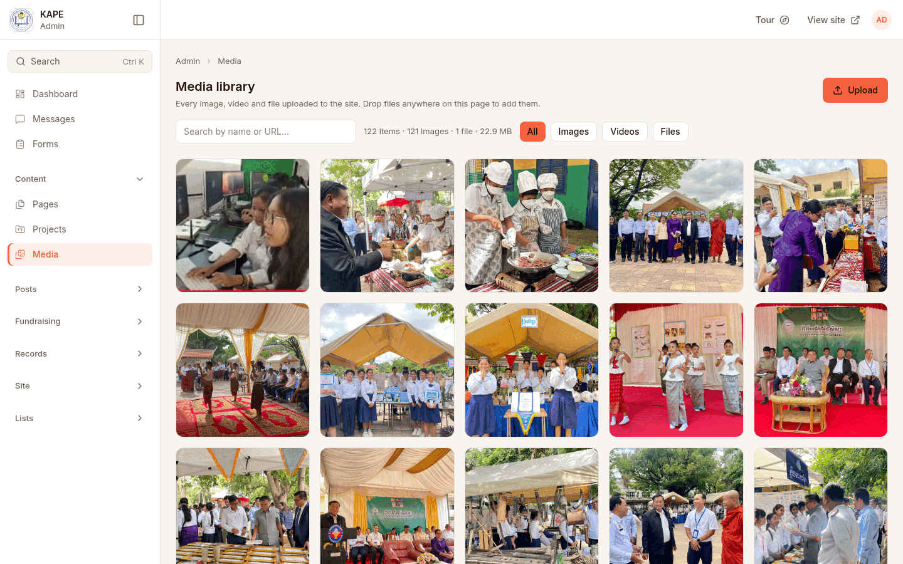

**Content → Media** is every file on the site: images, video and documents, in one place. The line
under the title counts what is there and how much space it takes.

### Upload

Two ways, and they do the same thing:

- **Upload** in the header, which lets you pick several files at once.
- **Drag files onto the page.** Anywhere on the page. A dashed panel appears to confirm you are over
  a drop target.

Uploads that are refused tell you why. The two you will hit:

- **"File type ... is not allowed"** — the file's extension is not on the allowed list. This is a
  security limit, not a setting. Convert the file, or ask an administrator.
- **"That file is empty"** — a zero-byte file, usually a failed download or a bad export.

Give files sensible names before you upload them. **The library stores them under a generated
name**, so a file called `IMG_4471.jpg` and one called `graduation-2026.jpg` are equally
unrecognisable afterwards. What makes an item findable is where it is used, not what it was called.

### Find and reuse

Search matches the file's stored name and its address. The chips narrow to **All**, **Images**,
**Videos** or **Files**. Files means everything that is not an image, so a video answers both that
chip and its own.

Any picker anywhere in the admin — a cover image, a logo, a section's photo — opens this same
library. Upload once, use it in ten places.

### Look at one

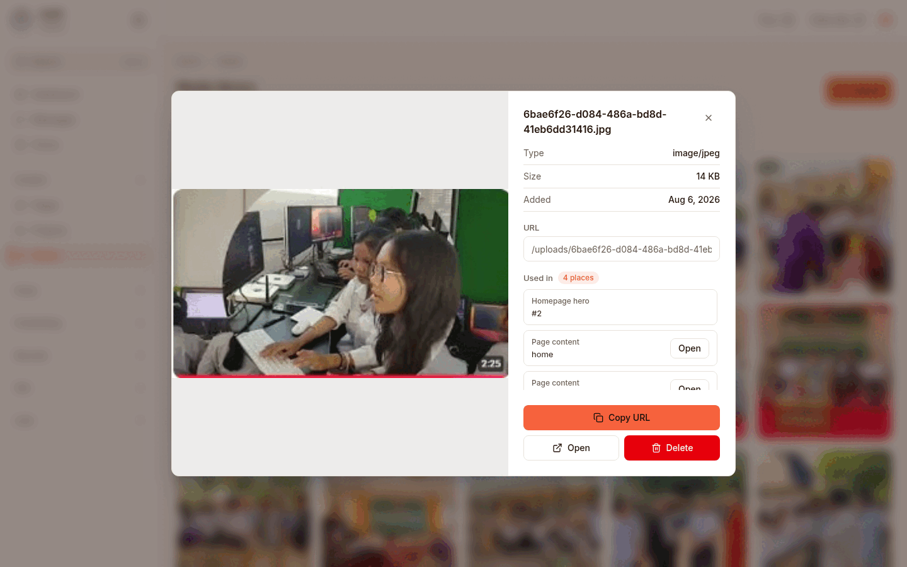

Click a tile. You get its type, size, the date it was added, its address with a **Copy URL** button,
and **Used in**.

**Used in is the important part.** It lists every page, post and record that points at this file, and
each one has an **Open** button that takes you there. "Unused" means nothing references it and it is
safe to remove.

### Delete safely

**Delete** is in the panel that opens when you click a tile, next to Copy URL. To remove several at
once, tick the checkbox in each tile's corner and use the bar that appears.

If the file is written into someone's article text, **the delete is refused** and the message names
what is holding it. Go and remove the image there first.

If the file is only used *as* something — a cover image, a logo — the delete goes through and that
record is simply left without a picture. Nothing breaks, but check the Used in list before you
confirm, because nobody will tell you afterwards.

---

## 5. Menus, footer and settings

### Put a page in the menu

Creating a page does not add it to the menu. That is deliberate: the menu is a decision, not a
side effect.

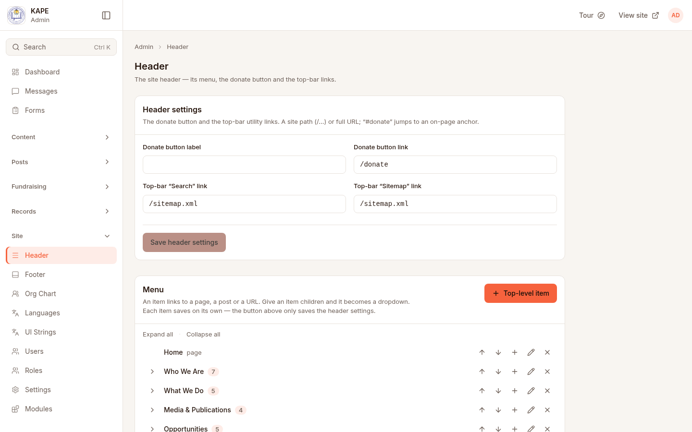

**Site → Header** is two things on one screen.

**Header settings** at the top is the donate button's label and link and the two top-bar utility
links. It has its own **Save header settings** button.

**Menu** below it is the navigation tree. **+ Top-level item** adds an entry; the `+` on a row adds a
child under it, which turns that row into a dropdown. The arrows reorder, the pencil edits, the `×`
removes. An item can point at a page, a post or any URL, and its label does not have to be the
page's title.

**Each menu item saves on its own.** The Save button above covers the header settings only, so an
edit to a menu row is already stored by the time you look away.

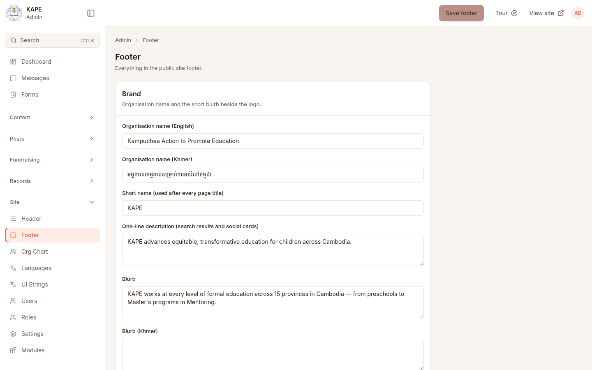

**Site → Footer** is the same job for the bottom of every page: link columns, the blurb, contact
details, social links, the newsletter box and the logos that sit down there.

### What the site says about itself

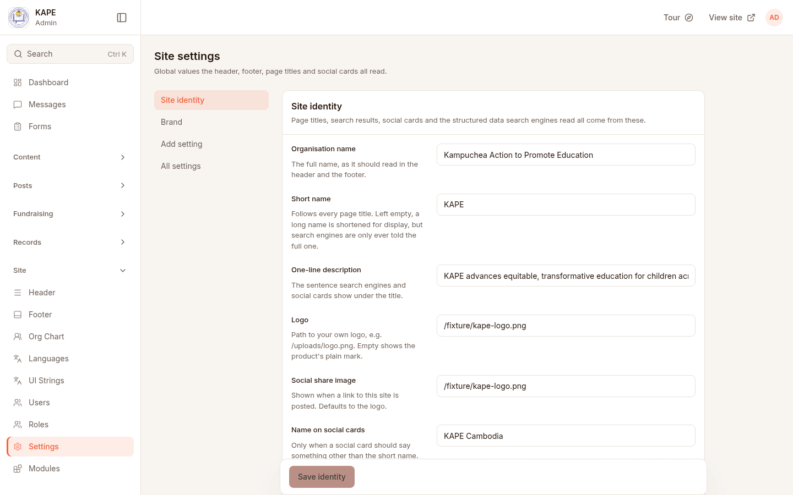

**Site → Settings** holds the values that are true of the whole site rather than of one page. It has
four sections down the left:

| Section | What it holds |
|---|---|
| **Site identity** | Organisation name, short name, one-line description, logo, social share image, and the region and country the site serves |
| **Brand** | The site's colours, and whether dark mode is offered at all |
| **Add setting** | Create a new key and value by hand |
| **All settings** | Everything else as a plain list, including `contact_email`, `contact_phone`, `social_facebook`, `telegram` and `youtube_url` |

Each section saves on its own. Change something here and it changes everywhere at once. That is the
point, and it is also the risk.

### Languages

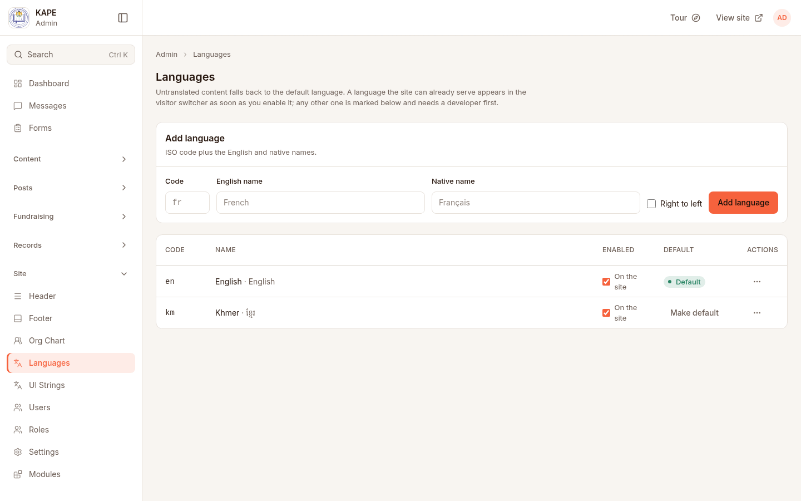

**Site → Languages** is which languages the site offers, which one is the default, and which are
switched on for visitors. Untranslated content falls back to the default language.

Adding a language here is not always enough. The site serves English and Khmer today; a language
outside that pair is added to the table and marked on this screen as needing a developer, because the
addresses for it (`/fr/...`) have to be turned on in the code first.

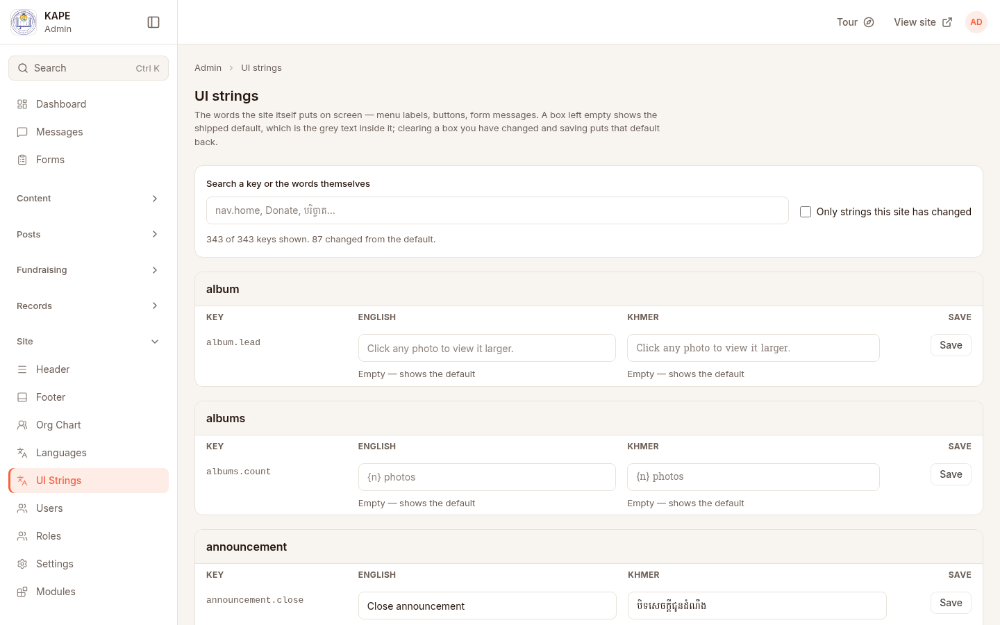

**Site → UI Strings** is the site's own furniture — button labels, "Read more", form messages —
translated. Your content lives on its own screens; this is everything the software says.

There are several hundred keys, so use the search box: it matches the key **and** the words
themselves, in either language. Tick **Only strings this site has changed** to see just what has been
overridden here.

**An empty box shows the shipped default**, greyed out inside it. Clearing a box you have changed and
saving puts that default back — it does not blank the label on the site.

### Modules

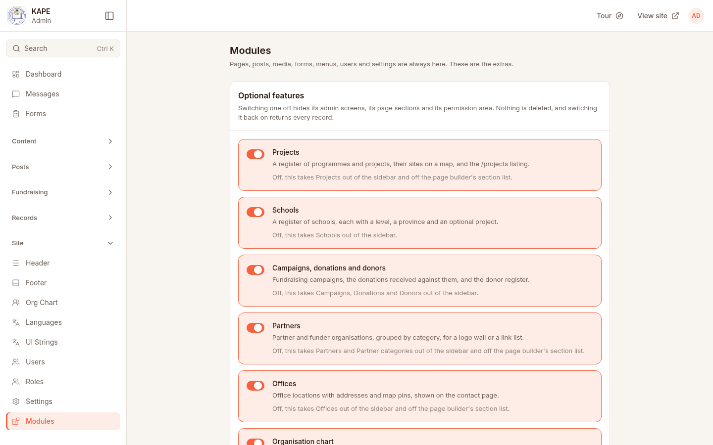

**Site → Modules** switches whole areas on and off. Turning one off hides its screens from every
sidebar and stops its public pages answering. An install that does not fundraise turns off
Fundraising and nobody sees a Campaigns screen again.

Nothing is deleted. Turn it back on and it is all still there.

---

## 6. People, forms and messages

### Users and roles

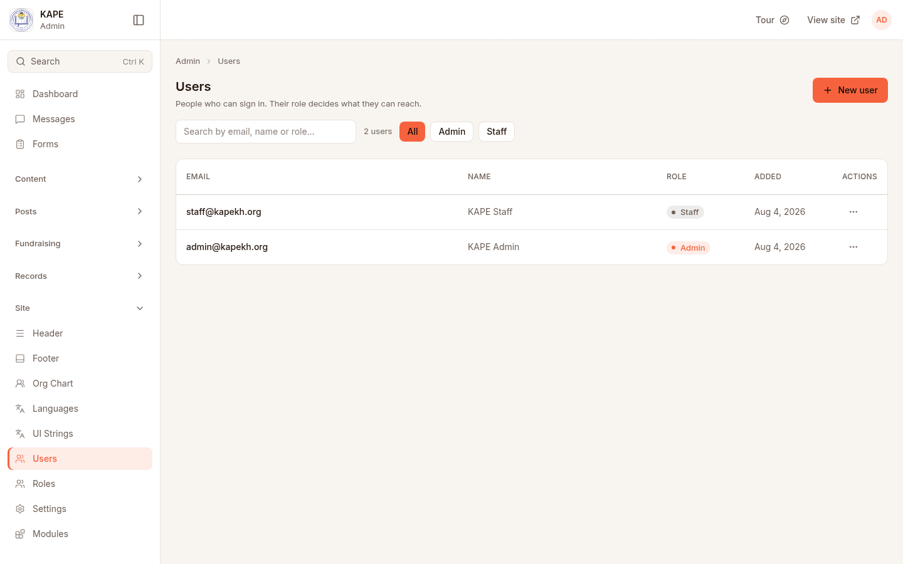

**Site → Users** is who can sign in. **Site → Roles** is what each role is allowed to reach.

A user holds one role, and the role carries the areas. So you do not give a person permissions —
you make a role that describes a job, and you give people that role.

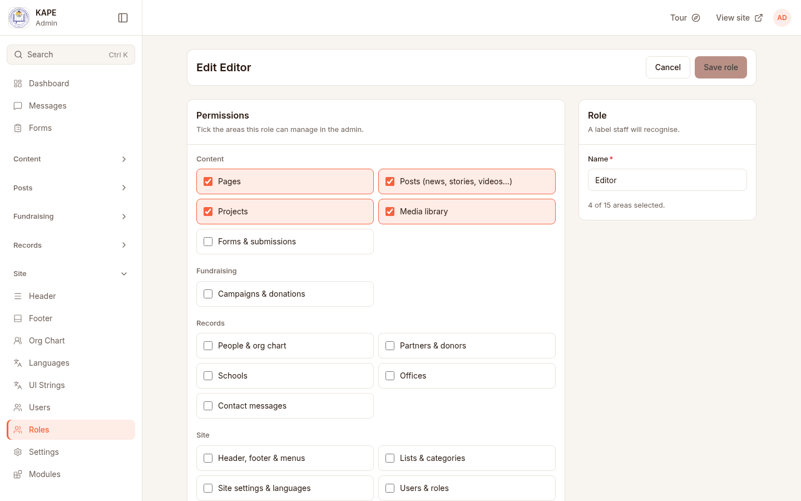

Fifteen areas, grouped the way the sidebar is:

- **Content** — Pages · Posts · Projects · Media library · Forms & submissions
- **Fundraising** — Campaigns & donations
- **Records** — People & org chart · Partners & donors · Schools · Offices · Contact messages
- **Site** — Header, footer & menus · Lists & categories · Site settings & languages · Users & roles

The count under the role's name tells you how many of the fifteen are ticked. **Administrator** is not
a role you build here; it is the super-role and it reaches everything.

Give a new colleague the narrowest role that lets them do their job. Widening a role later takes
seconds; explaining a deleted page does not.

### Forms

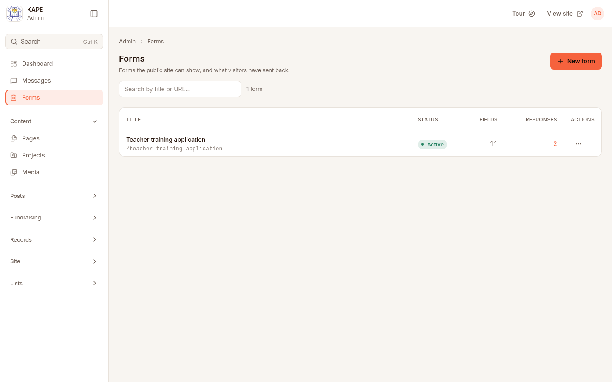

**Forms** builds the forms the public site can show: a contact form, an application, a survey.

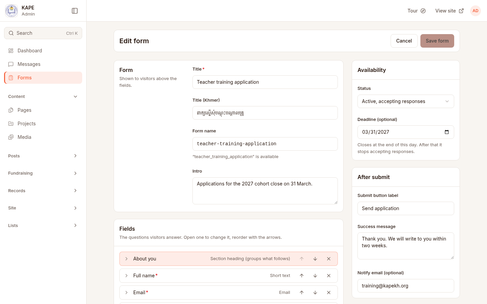

The left column is the form as a visitor meets it — its title in both languages, the internal name
that becomes its address, and the intro shown above the fields. Below that is **Fields**: one row per
question, reordered with the arrows, opened by clicking the row.

A **Section heading** field is not a question. It groups the ones that follow it, which is how a long
form stops feeling like a wall.

The right column is everything about the form rather than in it: whether it is accepting responses, a
deadline after which it closes itself, the submit button's label, the message shown after sending,
and an address to notify when something arrives.

Build the form, then put it on a page — either as a **Form** section, or embedded mid-article with
the editor's Form button.

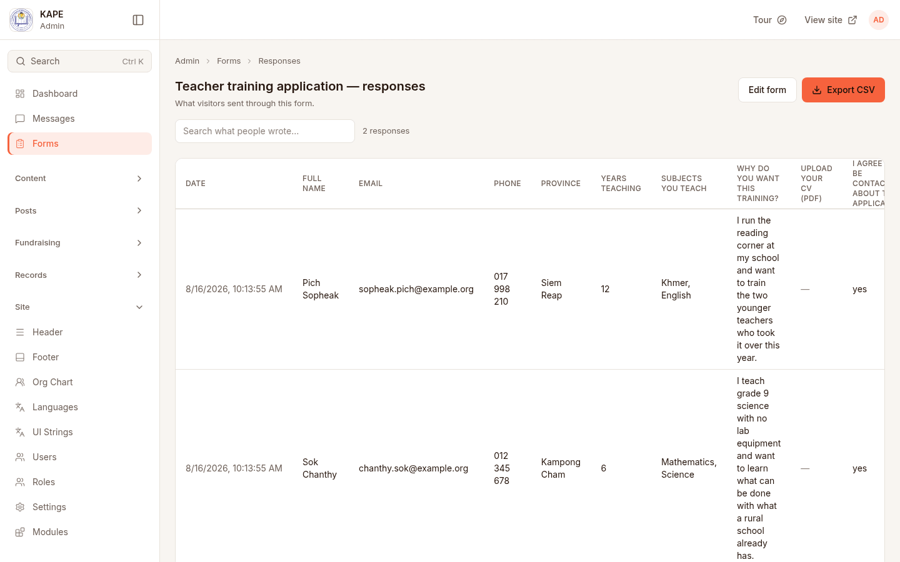

Each form has its own **Responses** screen, reached from the Forms list or from **Edit form**. One
row per submission, one column per field, searchable, with **Export CSV** for anything you want to
work through in a spreadsheet.

### Messages

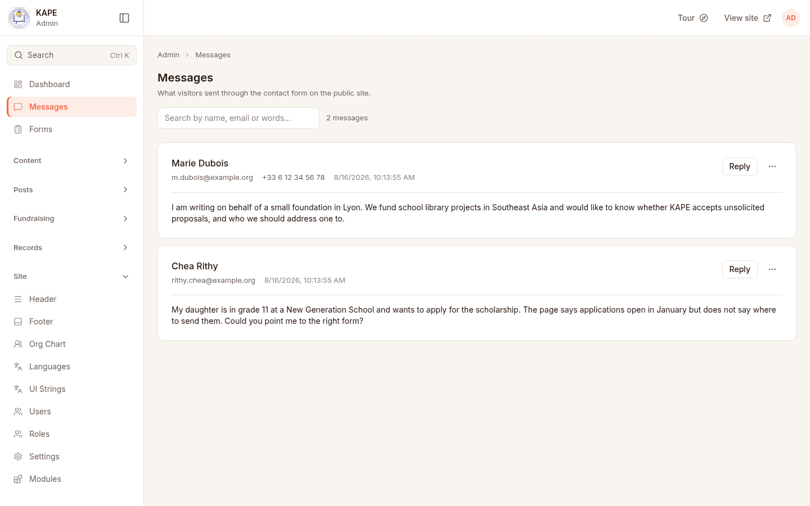

**Messages** is the contact form's inbox: who wrote, their email and phone, when, and what they said.

**Reply** opens a new mail in your own mail program, addressed to them. The site does not send it for
you, and it does not keep a copy.

Check this screen. **Nothing tells you a message is waiting** — no email goes out when one arrives.

---

## The rest of the sidebar

The five tours cover what most people touch. The remaining screens work the same way — a list with
search, count and chips, and an editor with the record on the left and its settings on the right.

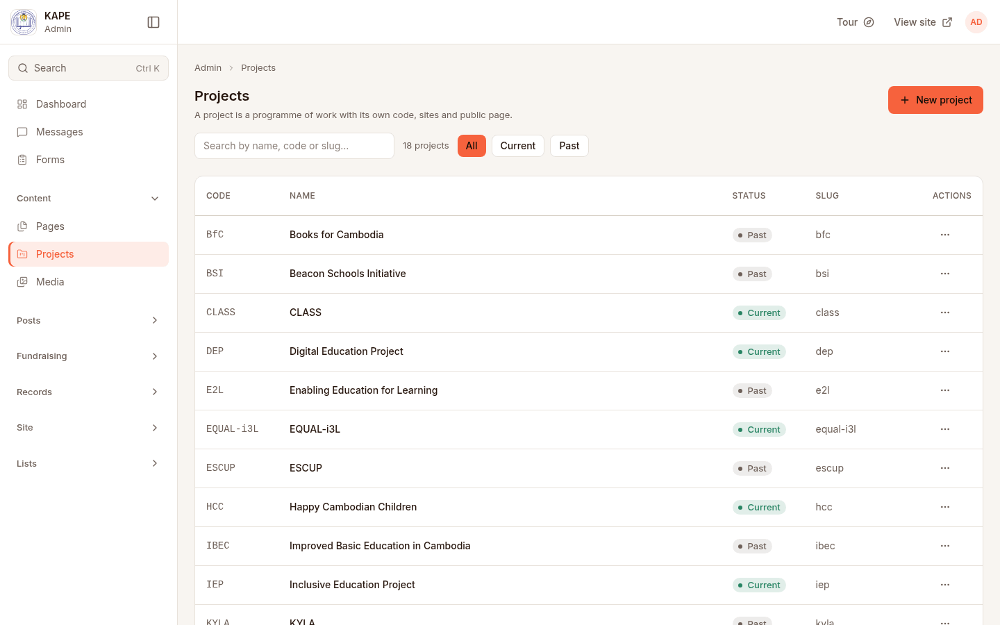

- **Content → Projects** is KAPE's programmes. A project can sit under another project, so a
  programme and its sub-projects are one tree, and it carries its own donors, locations and dates.
- **Records** is the reference data the public site draws on: Schools, People, Partners, Donors,
  Offices. A People directory or Partners section on a page reads these, so a record entered once
  appears everywhere it is relevant.
- **Fundraising** is Campaigns and the Donations they receive.
- **Site → Org Chart** is the org chart the Organization chart section draws.
- **Lists** holds the taxonomies that fill dropdowns elsewhere: Locations, and the publication,
  document and partner categories. **A term still in use cannot be deleted** — the refusal names how
  many records are holding it, so move them to another term first.

---

## When something looks wrong

**The public page did not change.** Pages are cached. Reload once; if it still looks old, confirm
the status is Published and that you saved.

**The page is not in the menu.** Menus are edited separately, under Site → Header.

**A screen is missing from my sidebar.** Either your role does not include it, or the module is
switched off. Both are tour 5 and tour 6.

**A field is empty on one language's site.** It was left blank on that language's tab. Blank stays
blank; it does not fall back.

**A delete was refused.** The message names what is holding the thing. Remove it there first, then
delete.

**I signed in and got sent straight back to the sign-in screen.** Your role has no areas at all. An
administrator has to give it some under Site → Roles.
